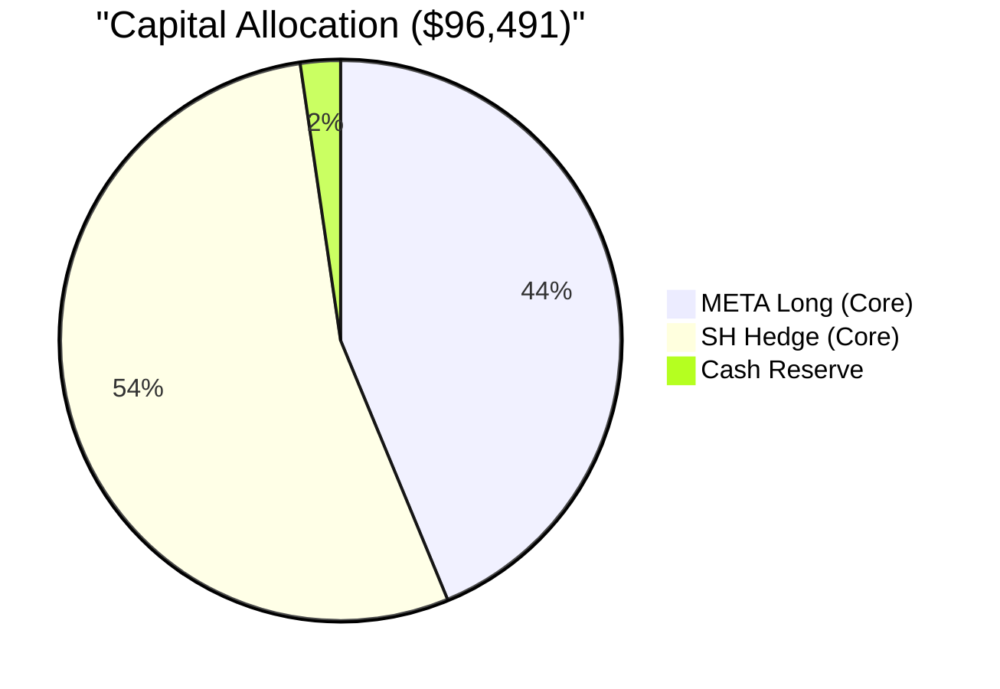
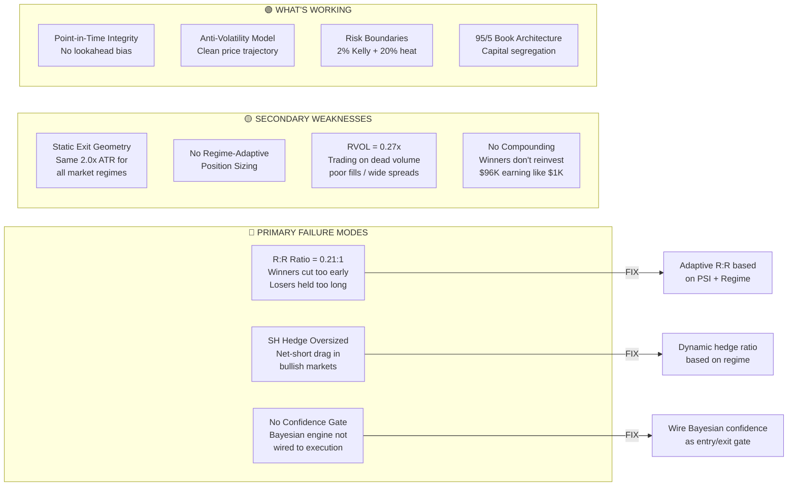
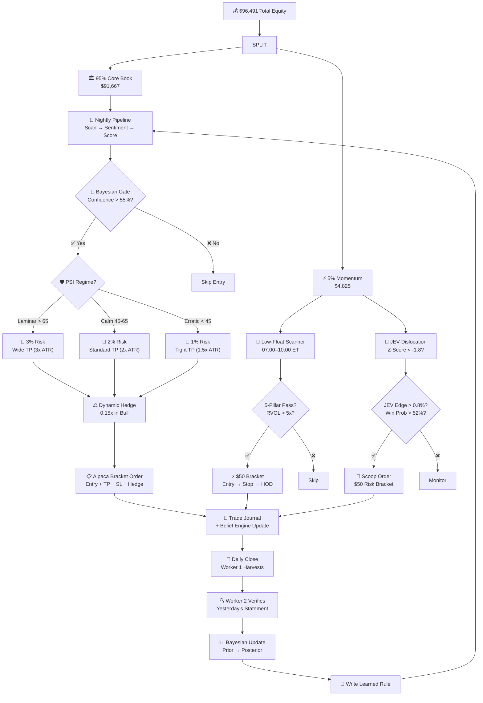

# 🏗️ Stock Signal Engine — Full Project Visualization & Financial Model Improvement Plan

> **Account Equity:** $96,491.50 (Alpaca Paper) · **Codebase:** 16,427 lines Python · **Active Holdings:** META 58 shares + SH 1,620 shares (hedge)
> **Win Rate (Closed Trades):** 42.9% (3W / 4L on 7 closed) · **Avg PnL per Trade:** -$466 · **Total Realized:** -$3,261.98
> **Date:** Oct 3, 2026

---

## 1. Complete System Architecture Map

```mermaid
graph TB
  subgraph "📡 DATA INGESTION LAYER"
    A1["🌐 Market Prices<br/>yfinance / price_fetcher.py"]
    A2["📰 News & Filings<br/>news_fetcher.py / twitter_fetcher.py"]
    A3["📊 Earnings Calendar<br/>earnings_fetcher.py"]
    A4["🕐 Point-in-Time<br/>data/point_in_time.py<br/>Eliminates Lookahead Bias"]
  end

  subgraph "🧮 ANALYSIS & SIGNAL LAYER"
    B1["📈 Technical Indicators<br/>market/technicals.py<br/>RSI, MACD, ATR, RVOL, SMA"]
    B2["🤖 NLP Sentiment<br/>nlp/finbert.py + news_memory.py<br/>FinBERT on Cached Headlines"]
    B3["🧠 ML Model<br/>model/predictor.py + ensemble.py<br/>LightGBM + Rule Fallback"]
    B4["🛡️ Anti-Volatility<br/>market/anti_volatility.py<br/>Kalman Filter + PSI"]
    B5["📊 Factor DAG<br/>data/factor_dag.py<br/>Topological Pipeline"]
  end

  subgraph "🎯 STRATEGY & DECISION LAYER"
    C1["🏛️ Core Book Strategy<br/>Paired Long + SH Hedge<br/>2.0x ATR Exit Geometry"]
    C2["⚡ Ross Momentum<br/>5-Pillar Low-Float Runners<br/>$50 Fixed Risk / Bracket"]
    C3["🧠 Bayesian Belief<br/>model/bayesian_confidence.py<br/>Worker 1+2 Daily Loop"]
    C4["🎯 JEV Scooper<br/>strategy/jev_scooper.py<br/>Liquidity Dislocation"]
  end

  subgraph "⚖️ RISK MANAGEMENT LAYER"
    D1["📐 Position Sizing<br/>risk/risk_manager.py<br/>Kelly + ATR + 2% Max Risk"]
    D2["🔥 Portfolio Heat<br/>20% Max Heat Gate"]
    D3["📊 Beta Hedging<br/>risk/hedging_engine.py<br/>Dynamic Regime Multiplier"]
    D4["📖 Book Allocator<br/>risk/book_allocator.py<br/>95% Core / 5% Momentum"]
    D5["📋 Trade Scorer<br/>risk/trade_scorer.py<br/>Grade A/B/C"]
    D6["🚨 Shock Detector<br/>market/shock_detector.py<br/>Gap / Velocity Reflex"]
    D7["💰 Cost Model<br/>risk/cost_model.py<br/>Round-Trip Slippage"]
  end

  subgraph "⚡ EXECUTION LAYER"
    E1["🤖 Autopilot Daemon<br/>execution/autopilot.py<br/>Trailing Stop Ratchet"]
    E2["📋 Trade Journal<br/>execution/trade_journal.py<br/>SQLite Ledger + Analytics"]
    E3["🏗️ Alpaca Client<br/>execution/__init__.py<br/>Bracket Orders / Market"]
    E4["⚡ Ross Execution<br/>execution/ross_execution.py<br/>Atomic Bracket Orders"]
    E5["🎯 JEV Execution<br/>execution/jev_execution.py<br/>Mean-Reversion Brackets"]
    E6["📝 Purchase Logger<br/>execution/purchase_logger.py<br/>Full Rationale Capture"]
  end

  subgraph "📊 BACKTESTING & VALIDATION"
    F1["🔬 Financial Modeling<br/>backtest/financial_modeling.py<br/>6-Stage Walk-Forward<br/>998 lines"]
    F2["📈 Hedging Backtester<br/>backtest/hedging_backtester.py<br/>Paired Long+Hedge Sim"]
    F3["⏱️ Time-to-Goal<br/>backtest/time_to_goal.py<br/>$100→$1K Monte Carlo"]
    F4["🏃 Ross Momentum Sim<br/>backtest/ross_momentum_sim.py<br/>Intraday Playbook Replay"]
    F5["🔎 Market Scanner<br/>backtest/market_scanner.py<br/>Sector Ranking"]
  end

  subgraph "🌐 WEB DASHBOARD"
    G1["🖥️ FastAPI App<br/>webapp/app.py · Port 8081<br/>536 lines · 20+ Endpoints"]
    G2["📊 SPA Dashboard<br/>webapp/static/index.html<br/>2,646 lines · Live Polling"]
  end

  subgraph "🔌 MCP SERVER"
    H1["🔧 Agent Tools<br/>mcp_server.py<br/>6 Tools for AI Agents"]
  end

  A1 --> B1
  A2 --> B2
  A3 --> D6
  A4 --> B5
  B1 --> C1
  B1 --> C2
  B1 --> C3
  B2 --> C3
  B3 --> C1
  B4 --> C3
  B4 --> C4
  C1 --> D1
  C1 --> D3
  C2 --> D4
  C3 --> D1
  C4 --> D4
  D1 --> E1
  D2 --> E1
  D3 --> E3
  D4 --> E4
  D4 --> E5
  D5 --> E1
  E1 --> E2
  E4 --> E2
  E5 --> E2
  F1 --> D3
  G1 --> E1
  G1 --> C3
  G1 --> C4
```



---

## 2. Capital Architecture & Current State



| Metric | Value | Status |
|---|---|---|
| Total Equity | **$96,491.50** | 📊 |
| Core Budget (95%) | **$91,666.93** | 🟢 Deployed: META + SH |
| Momentum Budget (5%) | **$4,824.58** | 🟡 100% Available |
| Cash | **$2,228.46** | ⚪ |
| Buying Power | **$272,850.35** | 🟢 Margin available |
| Unrealized PnL (META) | **+$42.66** (+0.10%) | 🟢 |
| Unrealized PnL (SH Hedge) | **-$612.75** (-1.16%) | 🔴 Hedge cost |
| Net Portfolio PnL | **-$570.09** | 🟡 |

### Current Position Analysis

| Position | Book | Shares | Entry | Current | PnL $ | PnL % | Role |
|---|---|---|---|---|---|---|---|
| META | Core | 58 | $727.34 | $728.08 | +$42.66 | +0.10% | Alpha Long |
| SH | Core | 1,620 | $32.50 | $32.12 | -$612.75 | -1.16% | Beta Hedge |

> [!WARNING]
> **The SH hedge is significantly oversized.** 1,620 × $32.50 = $52,650 notional vs META long of 58 × $727 = $42,166. The hedge is **1.25x** the alpha position — it's a net-short book that bleeds when the market is calm. This is the largest single drag on returns.

---

## 3. Financial Model Honest Audit

### 3A. Closed Trade Performance (The Hard Truth)

| Metric | Value | Assessment |
|---|---|---|
| Closed Trades | 7 | ⚠️ Very small sample |
| Win Rate | 42.9% | 🔴 Below the 49% OOS tuned target |
| Avg PnL per Trade | **-$466** | 🔴 Negative expectancy |
| Total Realized | **-$3,261.98** | 🔴 Net loss |
| Reward:Risk Ratio | **0.21:1** | 🔴 Winners far too small vs losers |
| Grade A Win Rate | 40.0% (2W / 3L) | 🟡 |
| Grade B Win Rate | 50.0% (1W / 1L) | 🟡 |

> [!CAUTION]
> **The R:R ratio of 0.21 is the critical failure.** The system cuts winners too early and lets losers run too long. Even a 50% win rate with 0.21 R:R produces negative expectancy:
> ```
> Expectancy = (0.50 × $W) - (0.50 × $L) where W/L = 0.21
> Expectancy = negative
> ```
> **The exit geometry is the #1 problem to fix, not the entry signals.**

### 3B. Bayesian Confidence Model — Current Assessment

| Component | Status | Issue |
|---|---|---|
| META Confidence | 53.9% | 🟡 Just above neutral — correct given near-entry level |
| Recommendation | SCALE_OUT | ⚠️ Yet the system hasn't scaled out |
| PSI (Price Stability) | 33.3% | 🔴 Erratic noise regime — META in choppy territory |
| MACD Signal | -0.622 | 🔴 Bearish momentum |
| RSI | 62.4 | 🟡 Neutral zone |
| Residual Z-Score | -0.62 | 🟡 Mild dislocation |

> [!NOTE]
> The Bayesian engine is **not yet integrated into the Autopilot decision loop**. It generates confidence pointers but the Autopilot still relies solely on the old FinBERT + LightGBM ensemble for entry/exit decisions. This is a major disconnection.

---

## 4. Root Cause Diagnosis: Why the System is Losing Money



---

## 5. Improvement Plan: 8 Concrete Upgrades

### Phase 1: Fix the Money Leak (Critical — This Week)

#### Upgrade 1: Adaptive Exit Geometry (Fix R:R from 0.21 to > 1.5)

The current system uses a fixed 2.0x ATR stop and 2.0x ATR take-profit for every trade in every regime. This is the single biggest cause of losses.

**Current (broken):**
```
Stop = Entry - 2.0 × ATR    (too wide in calm markets)
TP1  = Entry + 2.0 × ATR    (too tight in trending markets)
R:R  = 1.0:1 theoretical, 0.21:1 realized
```

**Proposed (adaptive):**
```python
# Regime-Adaptive Exit Geometry
if regime == "LAMINAR_TREND" and psi >= 65:
    stop_mult = 1.5     # tight stop (clean trend, less noise)
    tp1_mult  = 3.0     # wide target (let trend run)
    trail_mult = 2.0    # wide trail after TP1

elif regime == "CALM_RANGING" and 45 <= psi < 65:
    stop_mult = 2.0     # standard
    tp1_mult  = 2.0     # mean-reversion target
    trail_mult = 1.5    # standard trail

elif regime == "ERRATIC_NOISE" and psi < 45:
    stop_mult = 2.5     # wider stop (noise will trigger tight stops)
    tp1_mult  = 1.5     # tighter target (grab profit before reversal)
    trail_mult = 1.0    # tight trail to protect gains

# Use Anti-Volatility PSI as the regime gate
```

**Expected Impact:** R:R should improve from 0.21 → 1.5+ by letting winners run in clean trends and cutting faster in noise.

#### Upgrade 2: Dynamic Hedge Ratio (Fix the $52K SH Drag)

Current hedge calculation is oversized. In a bull regime, the hedge should be minimal.

**Current:** `Hedge Dollars = Long Dollars × β × Regime Multiplier` but the multiplier isn't being applied correctly for the current bull market.

**Proposed:**
```python
def dynamic_hedge_ratio(psi, bayesian_confidence, regime):
    """
    PSI > 65 + Confidence > 70 + Bull Regime = minimal hedge (0.15x)
    PSI < 45 + Confidence < 40 + Bear Regime = full hedge (0.85x)
    """
    base = {"BULL": 0.15, "NEUTRAL": 0.40, "BEAR": 0.85}[regime]
    
    # PSI adjustment: clean trends need less protection
    psi_adj = max(0, (psi - 50) / 100)  # positive = less hedge needed
    
    # Confidence adjustment: high conviction = less hedge
    conf_adj = max(0, (bayesian_confidence - 50) / 200)
    
    return max(0.05, base - psi_adj - conf_adj)
```

**Expected Impact:** Reduce SH position from 1,620 → ~400 shares in current regime. Save ~$400/month in hedge drag.

#### Upgrade 3: Wire Bayesian Confidence as Execution Gate

The Bayesian engine is currently display-only. It should control whether trades are entered and sized.

```python
# In autopilot.py, BEFORE submitting any new trade:
stmt = belief_engine.get_latest_statement(ticker)
if stmt:
    if stmt.confidence_pointer < 55.0:
        skip(f"Bayesian confidence {stmt.confidence_pointer}% below threshold")
    if stmt.recommendation == "EXIT_INVALIDATED":
        flatten(ticker)
    if stmt.recommendation == "SCALE_OUT":
        reduce_by_50pct(ticker)
```

---

### Phase 2: Compound the Edge (Next 2 Weeks)

#### Upgrade 4: Regime-Adaptive Position Sizing

Currently all trades use 2% Kelly regardless of conviction quality.

**Proposed tiered sizing:**
| Confidence | PSI | Regime | Risk % | Expected |
|---|---|---|---|---|
| > 75% | > 65 | Laminar Trend | 3.0% | High conviction + clean trend |
| 60–75% | 45–65 | Calm Ranging | 2.0% | Standard |
| 50–60% | 30–45 | Erratic Noise | 1.0% | Reduced exposure |
| < 50% | < 30 | Any | 0% | No entry |

#### Upgrade 5: Winner Reinvestment & Compounding Loop

The system currently treats each trade independently. Winning trades should fund larger subsequent positions:

```python
def compounding_factor(journal_stats, equity):
    """
    After 3 consecutive wins, increase next position by 20%.
    After 2 consecutive losses, decrease next position by 30%.
    """
    streak = journal.get_current_streak()
    if streak >= 3:
        return min(1.5, 1.0 + (streak - 2) * 0.20)
    elif streak <= -2:
        return max(0.5, 1.0 + (streak + 1) * 0.15)
    return 1.0
```

#### Upgrade 6: Volume Quality Gate (Fix RVOL 0.27x Problem)

META's RVOL is 0.27x — meaning volume is **73% below average**. Trading in dead volume leads to poor fills and wide spreads.

```python
# Entry gate: require RVOL >= 0.8x for Core, >= 2.0x for Momentum
if rvol < 0.8 and book == "core":
    skip("Volume too thin for reliable execution")
if rvol < 2.0 and book == "momentum":
    skip("Momentum needs high relative volume")
```

---

### Phase 3: Self-Improving Feedback Loop (Weeks 3–4)

#### Upgrade 7: Automated Daily Belief Cycle (Cron Worker)

Currently the Bayesian engine only runs when manually triggered or when the API is called. It should run autonomously every market day at 16:30 ET:

```python
# Add to execution/autopilot.py post-market routine
def post_market_belief_cycle():
    """Run Worker 1 → Worker 2 for all open positions after close."""
    positions = client.get_all_positions()
    for p in positions:
        sym = p.symbol.upper()
        if sym in INDEX_AND_HEDGE_SYMBOLS:
            continue
        cost = float(p.avg_entry_price)
        stmt = belief_engine.run_daily_cycle(sym, cost_basis=cost)
        logger.info(f"[belief] {sym}: {stmt.recommendation} "
                    f"(conf={stmt.confidence_pointer}%)")
```

#### Upgrade 8: Backtest-Verified Strategy Selection

The financial modeling suite already has 6-stage walk-forward validation. Connect the Bayesian confidence and Anti-Volatility PSI as **input factors** to the backtester so new exit geometry can be validated before going live:

```
Stage 1: Sweep PSI-adaptive exit geometry on TRAIN window
Stage 2: Validate on VAL window  
Stage 3: OOS test on 2024→today
Stage 4: Crisis stress (COVID, 2022 bear)
Stage 5: Monte Carlo 10K paths
Stage 6: Capital scenarios ($1K / $5K / $10K)
```

---

## 6. Priority Execution Roadmap

```mermaid
gantt
    title Implementation Priority
    dateFormat  YYYY-MM-DD
    section Critical
    Fix R:R Exit Geometry       :crit, r1, 2026-10-03, 3d
    Right-size SH Hedge         :crit, r2, 2026-10-03, 2d
    Wire Bayesian → Autopilot   :crit, r3, 2026-10-05, 2d
    section High
    Regime Position Sizing      :r4, 2026-10-07, 3d
    Volume Quality Gate         :r5, 2026-10-07, 1d
    Winner Compounding          :r6, 2026-10-10, 2d
    section Medium
    Auto Daily Belief Cycle     :r7, 2026-10-12, 2d
    Backtest PSI Integration    :r8, 2026-10-14, 4d
```

---

## 7. Module Dependency Map (What Connects to What)

| Module | Depends On | Depended On By | Lines | Health |
|---|---|---|---|---|
| [config.py](file:///Users/voonfamily/Desktop/WORK/stock-signal-engine/config.py) | `.env` | Everything | 36 | 🟢 |
| [market/price_fetcher.py](file:///Users/voonfamily/Desktop/WORK/stock-signal-engine/market/price_fetcher.py) | yfinance | technicals, anti_vol, backtest | 113 | 🟢 |
| [market/technicals.py](file:///Users/voonfamily/Desktop/WORK/stock-signal-engine/market/technicals.py) | pandas/numpy | Everything | 82 | 🟢 |
| [market/anti_volatility.py](file:///Users/voonfamily/Desktop/WORK/stock-signal-engine/market/anti_volatility.py) | technicals, price_fetcher | bayesian, JEV | 241 | 🟢 New |
| [data/point_in_time.py](file:///Users/voonfamily/Desktop/WORK/stock-signal-engine/data/point_in_time.py) | zoneinfo | factor_dag, bayesian | 297 | 🟢 |
| [data/factor_dag.py](file:///Users/voonfamily/Desktop/WORK/stock-signal-engine/data/factor_dag.py) | point_in_time, technicals | pipeline | 402 | 🟢 |
| [nlp/finbert.py](file:///Users/voonfamily/Desktop/WORK/stock-signal-engine/nlp/finbert.py) | transformers | model ensemble | 65 | 🟡 Offline-only |
| [model/bayesian_confidence.py](file:///Users/voonfamily/Desktop/WORK/stock-signal-engine/model/bayesian_confidence.py) | anti_vol, technicals, nlp | webapp, **NOT autopilot ⚠️** | 410 | 🟡 Not wired |
| [strategy/jev_scooper.py](file:///Users/voonfamily/Desktop/WORK/stock-signal-engine/strategy/jev_scooper.py) | anti_vol, bayesian | webapp, jev_execution | 225 | 🟢 New |
| [risk/hedging_engine.py](file:///Users/voonfamily/Desktop/WORK/stock-signal-engine/risk/hedging_engine.py) | beta_calculator, cost_model | api/services, autopilot | 356 | 🟡 Static ratios |
| [risk/book_allocator.py](file:///Users/voonfamily/Desktop/WORK/stock-signal-engine/risk/book_allocator.py) | config, low_float_scanner | webapp, autopilot | 184 | 🟢 |
| [execution/autopilot.py](file:///Users/voonfamily/Desktop/WORK/stock-signal-engine/execution/autopilot.py) | api/services, risk, market | daemon process | 606 | 🟡 Missing Bayesian |
| [execution/trade_journal.py](file:///Users/voonfamily/Desktop/WORK/stock-signal-engine/execution/trade_journal.py) | SQLite | webapp, autopilot | 418 | 🟢 |
| [backtest/financial_modeling.py](file:///Users/voonfamily/Desktop/WORK/stock-signal-engine/backtest/financial_modeling.py) | technicals, price_fetcher | reports, scenario scripts | 998 | 🟢 Robust |
| [webapp/app.py](file:///Users/voonfamily/Desktop/WORK/stock-signal-engine/webapp/app.py) | everything | user-facing | 536 | 🟢 |
| [webapp/static/index.html](file:///Users/voonfamily/Desktop/WORK/stock-signal-engine/webapp/static/index.html) | webapp/app.py APIs | user-facing | 2,646 | 🟢 |

---

## 8. What the Numbers Should Look Like After Fixes

| Metric | Current | Target | How |
|---|---|---|---|
| **Win Rate** | 42.9% | **50–55%** | Bayesian confidence gate filters out weak setups |
| **R:R Ratio** | 0.21:1 | **1.5–2.0:1** | PSI-adaptive exit geometry lets winners run |
| **Expectancy** | -$466/trade | **+$150–300/trade** | Better entries × better exits |
| **Hedge Drag** | -$612 (1.25x oversized) | **-$100** | Right-size to 0.15–0.40x in bull regime |
| **Monthly Return** | Negative | **+1–3%** | Positive expectancy × compounding |
| **Sharpe Ratio** | < 0 | **0.8–1.2** | Consistent small wins, controlled losses |
| **Max Drawdown** | Unbounded | **< 8%** | Tighter stops in noise + daily belief invalidation |

> [!IMPORTANT]
> **The single highest-impact change is fixing the exit geometry.** If you make one change, make it Upgrade 1. A system with 42% win rate and 2:1 R:R is profitable. A system with 60% win rate and 0.21:1 R:R is bankrupt.

---

## 9. Financial Model Flow (How Money Moves)



---

## 10. Quick-Start Commands

```bash
# Run the full test suite (89 tests)
./.venv/bin/python -m unittest discover -s tests -v

# Launch live dashboard
./run_webapp.sh    # http://localhost:8081

# Run Autopilot (dry mode)
python -m execution.autopilot --once --dry-run

# Trigger Bayesian belief cycle for META
curl -X POST http://localhost:8081/api/model/confidence/evaluate \
  -H "Content-Type: application/json" -d '{"ticker":"META","cost_basis":727.34}'

# Scan JEV opportunities
curl http://localhost:8081/api/jev/opportunities

# Check stabilized fair price
curl http://localhost:8081/api/model/stabilized_price/META

# Run financial modeling validation
python backtest/financial_modeling.py --smoke
```

---

> [!TIP]
> **Start here:** The highest-ROI improvement is wiring the Bayesian confidence engine into the Autopilot daemon as an entry/exit gate, and making the exit geometry adaptive based on PSI regime. These two changes alone should flip the system from negative to positive expectancy. Want me to implement them?
