```
stock-signal-engine/
├── ingestion/
│   ├── news_fetcher.py        # NewsAPI + RSS
│   ├── reddit_fetcher.py      # PRAW
│   ├── twitter_fetcher.py     # X API v2
│   └── earnings_fetcher.py    # SEC EDGAR
├── nlp/
│   ├── preprocessor.py        # Clean + chunk text
│   ├── finbert.py             # FinBERT sentiment scores
│   ├── ner.py                 # Entity → ticker mapping
│   └── topic_model.py         # BERTopic for earnings
├── market/
│   ├── price_fetcher.py       # yfinance / Polygon
│   └── indicators.py          # RSI, MACD, BB, ATR via pandas-ta
├── features/
│   └── feature_store.py       # Fuse NLP + market → feature vectors
├── model/
│   ├── trainer.py             # LightGBM training + CV
│   ├── finbert_booster.py     # Confidence adjustment layer
│   └── ensemble.py            # Weighted vote → BUY/SELL/HOLD
├── risk/
│   └── risk_manager.py        # Position sizing, stop loss
├── backtest/
│   └── backtester.py          # Vectorbt with slippage + walk-forward
├── execution/
│   └── alpaca_client.py       # Paper → live Alpaca orders
├── api/
│   └── main.py                # FastAPI endpoints
├── dashboard/                 # React frontend
├── config.py
├── requirements.txt
└── docker-compose.yml
```

## Layer 1
so in here we will be start in the news ingestion, so 
our only jobis fetching the raw text from the external sources, and normalizes it into a consistant shape, and handed it downstream

so in returning 
the output of the fetcher should be like this 
{
    "source" : "newsapi"
    "ticker" : "AAPL" 
    "title" : "Apple ... " 
    "body" : "Full article text .. "
    "publishing_at" : "2025-03-14T10:00:00Z" # always be in UTC ISO8601
    "url" : "https://..."
}

this is [schema contract], this downstream code should be output as this shape regradless where it is come from Reddit, NewsAPI or X. 


